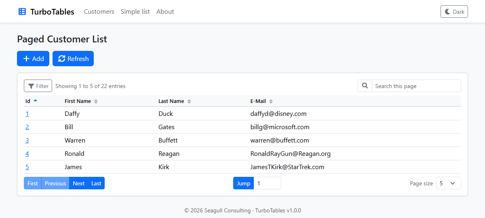

# TurboTables

A small, dependency-free JavaScript library that adds **server-side paging, sorting and filtering** controls (plus client-side search of the current page) to an HTML table styled with **Bootstrap 5** and **Font Awesome 7**.

What it adds around your table:

* **Toolbar (above):** "Showing x to y of z entries" on the left and a search box for the current page on the right. With `showFilter: true`, a **Filter** button on the left opens inline filter controls (column, value, Apply, Clear). While they are closed, an applied filter is shown as a removable chip, e.g. `Last Name: Duck ×`.
* **Header:** sortable columns get a faint sort icon; the active column shows its direction in the primary colour.
* **Pager (below):** First / Previous / Next / Last on the left, Jump to page in the middle, Page size on the right.
* **Loading:** the table is dimmed with a spinner over it while data loads.

Colours come from Bootstrap 5.3's CSS variables, so the controls follow light/dark mode and Bootswatch themes.



This repository contains:

| Path | What it is |
|---|---|
| `dist/` | The released library files: `turbotables.js`, `turbotables.min.js` (+ source map), `turbotables.css`, `turbotables.min.css` |
| `TurboTables/public/javascripts/turbotables.js` | Library source |
| `TurboTables/` | Demo app (Node.js, Express 5, Handlebars) and tests |
| `docs/images/` | README screenshots |
| `Linux/` | systemd unit for the demo server (`turbotables.service`) |
| `CHANGELOG.md` | Release history, including breaking changes |

## Installing in an ASP.NET Core app (LibMan)

Releases are git tags (`v1.0.0`, ...). jsDelivr serves the files in `dist/` for any tag, so LibMan can install a pinned version. Add this to the app's `libman.json` (write the library as `owner/repo@tag` without jsDelivr's `gh/` prefix; LibMan adds it):

```json
{
  "provider": "jsdelivr",
  "library": "wbwiltshire/TurboTables@v1.0.0",
  "destination": "wwwroot/lib/turbotables/",
  "files": [ "dist/turbotables.min.js", "dist/turbotables.min.js.map", "dist/turbotables.min.css" ]
}
```

Run `libman restore` (Visual Studio does this on build). To upgrade, change the version and restore again.

Reference the files from your layout or view. TurboTables needs Bootstrap 5 CSS and Font Awesome 7 (for the filter and sort icons). It doesn't need jQuery.

```html
<link rel="stylesheet" href="~/lib/turbotables/dist/turbotables.min.css" asp-append-version="true" />
<script src="~/lib/turbotables/dist/turbotables.min.js" asp-append-version="true"></script>
```

## Usage

### 1. Markup

```html
<div class="row">
    <div class="col-md-12">
        <table id="CustomerTable" ctTotalItems="100" class="table table-striped table-bordered table-sm table-hover">
            <thead>
                <tr class="colHeaders">
                    <th data-column="Id" class="sortable filterable"><a href="#">Id</a></th>
                    <th data-column="FirstName" class="sortable filterable"><a href="#">First Name</a></th>
                    <th data-column="LastName" class="sortable filterable"><a href="#">Last Name</a></th>
                    <th data-column="EMail" class="sortable filterable"><a href="#">E-Mail</a></th>
                </tr>
            </thead>
            <tbody id="CustomerList"></tbody>
        </table>
    </div>
</div>
```

* Give the `table` an `id` and a total-items attribute (`ctTotalItems` by default) holding the total row count.
* Put the `colHeaders` class (configurable) on the header `tr`. If no row has it, the first `thead` row is used.
* Mark the header cells you want to sort or filter on with `sortable` / `filterable`.
* Name each column with `data-column` (the server-side property name). An `id` still works, but ids must be unique on the page.
* The toolbar and pager are inserted before and after the nearest `.row` that contains the table (or the `container` option).
* The table is wrapped in a `div.tt-wrapper` (for the loading overlay) and gets the `tt-table` class (header styling). Pass `classes: { table: '' }` to skip the header styling.

### 2. Script

```js
const customerTable = new TurboTablesLib({
    tableId: 'CustomerTable',
    totalItemsAttribute: 'ctTotalItems',
    page: 1,
    pageSize: 10,
    pagerSizeOptions: [[10, 25, 50, -1], [10, 25, 50, 'All']],
    sortColumn: 'Id',
    sortDirection: 'asc',
    showFilter: true
});

customerTable.setDataBinding(loadCustomers);

// TurboTables calls this whenever the page, page size, sort or filter changes.
async function loadCustomers(page, pageSize, sortColumn, direction, filterColumn, filterValue, requestId) {
    try {
        const response = await fetch('/api/customer/?' + customerTable.buildQueryString());
        const result = await response.json();
        if (!customerTable.isCurrentRequest(requestId)) return;     // a newer request has started
        bindGrid(result.customers);                                  // e.g. with a Handlebars template
        customerTable.endDataBinding(result.totalItems, requestId);
    } catch (err) {
        customerTable.endDataBinding(0, requestId);                  // always end, or the spinner keeps spinning
    }
}

document.getElementById('refresh').addEventListener('click', () => customerTable.refresh());
```

`buildQueryString(extraParams)` returns `page`, `pageSize`, `sortColumn`, `direction` and (when a filter is active) `filterColumn` and `filterValue`, all URL-encoded. Pass an object to add your own parameters, e.g. `buildQueryString({ id: 7 })`.

If you render rows with Handlebars, use `{{value}}` (HTML-escaped). Never use `{{{value}}}` for data from the server.

### Options

| Option | Default | Notes |
|---|---|---|
| `tableId` | *(required)* | |
| `totalItemsAttribute` | `'ctTotalItems'` | Table attribute holding the initial total |
| `page` | `1` | |
| `pageSize` | `10` | `-1` means "All". Added to the page-size list if it isn't already there |
| `pagerSizeOptions` | `[[10,25,50,-1],[10,25,50,'All']]` | `[values, labels]` |
| `sortColumn` / `sortDirection` | `'Id'` / `'asc'` | Direction is case-insensitive and is always sent lowercase |
| `showFilter` | `false` | Shows the Filter button, filter panel and filter chip |
| `columnHeaderClass` | `'colHeaders'` | |
| `spinnerSource` | none | Image URL shown in the loading overlay. Without it a Bootstrap `spinner-border` is shown |
| `tableInfoTemplate` | `'Showing {0} to {1} of {2} entries'` | |
| `container` | nearest `.row` | Element (or id) the controls are placed around |
| `classes` | Bootstrap 5 classes | Override any generated element's classes, e.g. `{ pagerButton: 'btn btn-outline-primary' }`. Keys are listed in `DEFAULT_CLASSES` at the top of `turbotables.js` |
| `icons` | Font Awesome 7 | `{ filter, search, sortNone, sortAsc, sortDesc }`. Set `sortNone: ''` to hide the neutral sort icon |

### Methods

| Method | |
|---|---|
| `setDataBinding(fn)` | Sets the data-loading function (see signature above) |
| `endDataBinding(totalItems[, requestId])` | Call after binding, **including on errors**. Returns `false` and does nothing for a superseded `requestId` |
| `isCurrentRequest(requestId)` | |
| `refresh()` | Re-requests the current page |
| `buildQueryString([extraParams])` | |
| `goToPage(n)` | |
| `getPage()`, `getPageSize()`, `getLastPage()`, `getSortColumn()`, `getSortDirection()`, `getFilterColumn()`, `getFilterValue()` | Filter getters return the *applied* filter |
| `showSpinner(show)` | |

Generated elements get ids prefixed with the table id (`CustomerTable-next`, `CustomerTable-search`, ...), so several tables can share a page.

### Server-side responsibilities

TurboTables only sends what the user picked, so the server must:

* **Allowlist** `sortColumn`, `direction` and `filterColumn` against known property names. Never concatenate them into SQL or Dynamic LINQ.
* **Cap** `pageSize`. "All" sends the current total, which a caller can replace with any number.
* Return the total row count for the current filter, so `endDataBinding(totalItems)` can update the pager.

## The demo app

Requires Node.js 20 or later.

```
cd TurboTables
npm install
npm run dev          # http://localhost:5000, restarts on file changes (settings in dev.env)
npm test             # Vitest + jsdom (run from PowerShell; Vitest fails to start in Git Bash)
npm run build        # rebuild dist/
```

In VS Code use **Run > Start Debugging** (F5). Both F5 and `npm run dev` load `TurboTables/dev.env` (`NODE_ENV=development`, port 5000 and a 1.5 second simulated delay so the loading overlay is visible); variables already set in your environment win. Stop the debugger with **Shift+F5**, and a terminal `npm run dev` with **Ctrl+C**. Only run one instance at a time: on Windows a second copy can start on the same port without an error, and the browser keeps talking to the first one.

Environment variables:

| Variable | Default | |
|---|---|---|
| `PORT` | `5000` | |
| `HOST` | *(all interfaces)* | Address to listen on, e.g. `172.17.0.1` so only Docker containers (Nginx Proxy Manager) can reach it |
| `NODE_ENV` | *(unset)* | Only `development` shows stack traces and uses the short `dev` log format |
| `TRUST_PROXY` | *(unset)* | Set behind a reverse proxy so logs show real client IPs: a subnet such as `172.17.0.0/16`, `loopback`, or a hop count such as `1` |
| `DEMO_DELAY_MS` | `0` | Simulated API latency |

## Releasing a new version

1. Update the version in `TurboTables/package.json`, in the banner and `VERSION` constant at the top of `turbotables.js`, and in the banner of `turbotables.css`. The build fails if they disagree.
2. `npm run build` then `npm test`. A test fails if `dist/` is out of date.
3. Add an entry to `CHANGELOG.md`, commit, and tag: `git tag v1.1.0 && git push origin v1.1.0`.
4. In each app, bump the version in `libman.json` and run `libman restore`.

Never move or re-push an existing tag. jsDelivr caches tagged files permanently.

## Deploying the demo to DebServer1

The demo runs as a systemd service on DebServer1. Nginx Proxy Manager (NPM), running in Docker on the same host, forwards to it on the Docker bridge at `172.17.0.1:8006`, so the app isn't reachable from the network directly. The unit file is [`Linux/turbotables.service`](Linux/turbotables.service). Requires Node.js 20 or later on the server.

1. Build the release tarball on your workstation (PowerShell; Windows 10 and later include `tar`):
   ```
   cd TurboTables
   tar -czf turbotables-demo.tgz app.js config.js validation.js repository.js customer.json package.json package-lock.json public routes views
   scp turbotables-demo.tgz ../Linux/turbotables.service debserver1:~
   ```
2. On the server, install into an empty folder (move any previous install aside first) and install only the runtime packages:
   ```
   sudo systemctl stop turbotables.service      # if it is already installed
   sudo mv /web/TurboTables /web/TurboTables.old  # if a previous version exists
   sudo mkdir -p /web/TurboTables
   sudo tar -xzf ~/turbotables-demo.tgz -C /web/TurboTables
   cd /web/TurboTables
   sudo npm ci --omit=dev
   sudo chown -R root:www-data /web/TurboTables
   sudo chmod -R u=rwX,g=rX,o= /web/TurboTables
   ```
   The service user (`www-data`) only needs read access.
3. Install the service file and start it:
   ```
   sudo cp ~/turbotables.service /etc/systemd/system/turbotables.service
   sudo systemctl daemon-reload
   sudo systemctl enable --now turbotables.service
   curl -I http://172.17.0.1:8006/
   sudo journalctl -u turbotables.service -f
   ```
   The log should start with `TurboTables demo listening on 172.17.0.1, port 8006`.
4. In NPM, the proxy host forwards to `http://172.17.0.1:8006` (scheme `http`), with SSL enabled on the NPM side.
5. Check it through NPM: browse the demo, and confirm `/api/customer/?page=1&page=2&filterValue=a&filterValue=b` returns JSON and the service is still running afterwards. The journal's access log lines should show real client IPs, not `172.17.0.x`.

For later updates, repeat steps 1–2 and run `sudo systemctl restart turbotables.service`. When the new version is working, remove the old folder (`sudo rm -rf /web/TurboTables.old`).

## FAQ

1. **Why aren't my columns sorting?**
   * The header needs the `sortable` class and a `data-column` (or `id`).
   * The server must implement sorting on that property name.
2. **Why isn't "Showing x to y of z entries" displayed, or the controls are in the wrong place?**
   * Wrap the table in a Bootstrap `.row` / column `div`, or pass the `container` option.
3. **The spinner never stops.**
   * Call `endDataBinding()` in your error handler too.

## More information
* [Bootstrap](https://getbootstrap.com/) · [Bootswatch](https://bootswatch.com/) · [Font Awesome](https://fontawesome.com/icons) · [Handlebars](https://handlebarsjs.com/) · [Express](https://expressjs.com/)
* [LibMan](https://learn.microsoft.com/aspnet/core/client-side/libman/) · [jsDelivr GitHub CDN](https://www.jsdelivr.com/?docs=gh)
